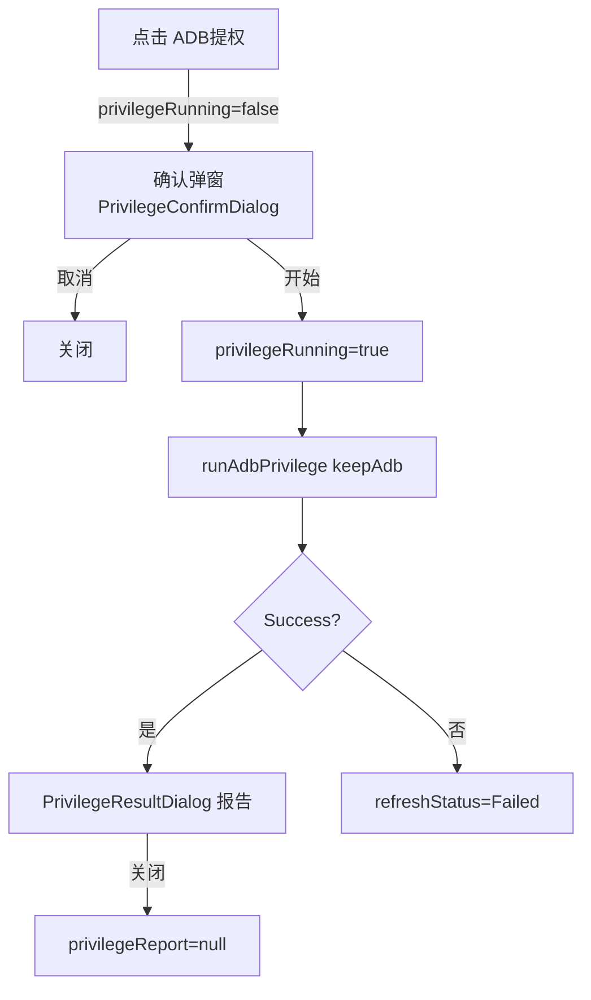

# ADB 提权功能 · 需求说明与实现逻辑（可复用）

> 来源项目：skyadb（Compose Multi 移动端 ADB 管理器）
> 适用场景：无 root 的 Android TV / 盒子，通过 ADB 批量授予系统级能力（类 root 效果）
> 复用方式：拷贝第 8 节列出的文件 + 适配目标应用包名/组件 + 字符串资源，即可接入新项目

---

## 1. 功能概述

通过 `adb shell` 逐条执行一组预定义命令，为目标应用（默认 **`app.orchard.tv`**，即 Aerial 电视桌面）完成：

- 授予 ADB 专属权限（`pm grant` / `appops set` / 通知监听等）
- 冷启动一次并编译优化，提升运行速度
- 接管系统屏保（Aerial 屏保）
- 保持 ADB 常开（用户可选）
- 设为系统默认桌面（含失败回退命令）
- 注册无障碍服务实现"桌面守护"（防 Home 键退出）

每条命令的执行结果（成功 / 失败 / 跳过）都会汇总成可视化报告，供用户逐条查看。

---

## 2. 功能需求（验收标准）

| # | 需求 | 说明 |
|---|------|------|
| R1 | 入口 | 设备详情页「快捷操作」区提供「ADB 提权」按钮；会话为 USB Fastboot 时不可用 |
| R2 | 确认弹窗 | 点击后弹出确认框，说明提权内容与风险；含「保持 ADB 常开」开关，默认开启 |
| R3 | 执行中状态 | 确认后隐藏弹窗、显示进行中状态；执行期间禁止重复触发（防重入） |
| R4 | 结果报告 | 执行结束弹报告：按 7 个步骤分组展示，每条命令含 状态徽标 + 命令全文 + 输出摘要 |
| R5 | 容错 | 单条命令失败不中断流水线（标记 FAILED 继续执行后续步骤）；整组可因条件不满足而 SKIPPED（附原因） |
| R6 | 统计与日志 | 报告头部显示 成功/失败/跳过 统计；存在失败时写入诊断日志 |
| R7 | 关闭 | 用户可关闭报告，不影响设备连接状态 |

---

## 3. 交互流程（UI 状态机）

```
点击「ADB 提权」
    │  privilegeRunning == true？→ 忽略（防重入）
    ▼
onPrivilegeClick() → privilegeConfirmVisible = true
    ▼
PrivilegeConfirmDialog（确认框 + 保持ADB开关）
    ├─ 取消 → onPrivilegeDismiss() → 关闭弹窗
    └─ 开始 → onPrivilegeConfirm()
            ├─ privilegeConfirmVisible=false, privilegeRunning=true, privilegeReport=null
            ├─ adbRepository.runAdbPrivilege(keepAdb)   ← suspend，串行执行 7 组命令
            ├─ Success → privilegeReport = report（弹结果框）
            └─ Failure → refreshStatus = Failed（提示区展示错误）
    ▼
PrivilegeResultDialog（report）
    └─ 关闭 → onPrivilegeResultDismiss() → privilegeReport = null
```



**ViewModel 状态字段**（`DeviceUiState`）：

| 字段 | 类型 | 含义 |
|------|------|------|
| `privilegeConfirmVisible` | Boolean | 确认弹窗是否显示 |
| `privilegeKeepAdb` | Boolean | 「保持 ADB 常开」开关值（默认 true） |
| `privilegeRunning` | Boolean | 提权流水线执行中标记（防重入） |
| `privilegeReport` | `AdbPrivilegeReport?` | 执行结果报告；非空时弹结果框 |

**ViewModel 方法**：`onPrivilegeClick()`、`onPrivilegeDismiss()`、`onPrivilegeKeepAdbChange(Boolean)`、`onPrivilegeConfirm()`、`onPrivilegeResultDismiss()`。

---

## 4. 核心执行逻辑（7 组命令流水线）

`AdbRepository.runAdbPrivilege(keepAdbEnabled: Boolean)` 串行执行，产出 `AdbPrivilegeReport`。

| 步骤 | 枚举 | 命令 | 判定 / 跳过逻辑 |
|------|------|------|----------------|
| ① 授权 | `GrantPermissions` | 13 条 `pm grant` / `appops set` / `cmd notification`（见 §5 表） | 逐条执行，各自独立判定成败，不相互中断 |
| ② 编译优化 | `CompileOptimize` | ① `am start -W -n <MainActivity>`（启动）② 固定等待 **5 秒** ③ `cmd package compile -m speed -f <pkg>` | 先启动、等 5s、再编译，3 条按序记录 |
| ③ 屏保接管 | `Screensaver` | 先查 `settings get secure screensaver_enabled`；仅当输出为 `"1"` 才追加 ② `settings put secure screensaver_components <AerialDream>` ③ `am broadcast ... --ez own_screensaver true` | 条件不满足时整组 **SKIPPED**（附跳过原因） |
| ④ 保持 ADB | `KeepAdb` | `am broadcast ... --ez keep_adb true` | 用户开关关闭时整组 **SKIPPED** |
| ⑤ 启动 Aerial | `LaunchAerial` | `am start -W -n <MainActivity>` | **requireStatusOk**：exitCode==0 且输出含 `"Status: ok"` 才算成功 |
| ⑥ 默认桌面 | `DefaultHome` | 主命令 `cmd role add-role-holder --user 0 android.app.role.HOME <pkg>`；失败时追加回退 `cmd package set-home-activity --user 0 <MainActivity>` | 主命令成功则只记录 1 条；失败则记录 2 条（含回退） |
| ⑦ 桌面守护 | `HomeGuard` | ① 读 `enabled_accessibility_services` 原值 ② 合并新值写回 ③ `settings put secure accessibility_enabled 1` | 合并规则见 §6.5；原值非空且非 `"null"` 时冒号追加，否则直接使用新组件 |

执行完成后统计 `failedCount > 0` 时调用 `DiagnosticLogger.record` 记诊断日志，随后 **无论成败都返回 `Success(report)`**（单命令失败通过 report 呈现，不使整次操作为失败）。

---

## 5. 命令清单（需适配目标应用）

`AdbPrivilegeCommands` 常量（复用项目必须替换为自身包名/组件）：

| 常量 | 当前值（Aerial） | 用途 |
|------|------------------|------|
| `TARGET_PACKAGE` | `app.orchard.tv` | 目标应用包名 |
| `MAIN_ACTIVITY` | `app.orchard.tv/.MainActivity` | 主 Activity（启动/默认桌面） |
| `CONFIG_RECEIVER` | `app.orchard.tv/.guard.ConfigReceiver` | 配置广播接收器（屏保/保持ADB） |
| `REVIVAL_LISTENER` | `app.orchard.tv/app.orchard.tv.guard.RevivalListener` | 通知监听器（复活） |
| `AERIAL_DREAM` | `app.orchard.tv/app.orchard.tv.dream.AerialDream` | 屏保组件 |
| `HOME_GUARD_SERVICE` | `app.orchard.tv/app.orchard.tv.guard.HomeGuardService` | 桌面守护无障碍服务 |

**组① 授权命令（13 条，逐条执行）**：

```
pm grant <pkg> android.permission.ACCESS_FINE_LOCATION
pm grant <pkg> android.permission.WRITE_SECURE_SETTINGS
appops set <pkg> SYSTEM_ALERT_WINDOW allow
appops set <pkg> WRITE_SETTINGS allow
appops set <pkg> REQUEST_INSTALL_PACKAGES allow
appops set <pkg> GET_USAGE_STATS allow
appops set <pkg> android:get_usage_stats allow
appops set <pkg> ACCESS_RESTRICTED_SETTINGS allow
cmd notification allow_listener <REVIVAL_LISTENER>
appops set <pkg> APP_AUTO_START allow
appops set <pkg> APP_ASSOC_START allow
appops set <pkg> AUTO_START allow
appops set <pkg> ASSOC_START allow
```

> 提示：不同厂商系统（小米/当贝/天猫魔盒等）对自启动 appops 项支持不同，失败会自动标记 FAILED 不中断，无需额外处理。

---

## 6. 数据模型与关键算法

### 6.1 步骤枚举
```kotlin
enum class PrivilegeStep { GrantPermissions, CompileOptimize, Screensaver, KeepAdb, LaunchAerial, DefaultHome, HomeGuard }
```

### 6.2 命令状态
```kotlin
enum class PrivilegeCommandState { SUCCESS, FAILED, SKIPPED }
```

### 6.3 结果结构
```kotlin
data class PrivilegeCommandResult(val command: String, val state: PrivilegeCommandState, val output: String = "")
data class PrivilegeStepResult(val step: PrivilegeStep, val commands: List<PrivilegeCommandResult>, val skippedReason: String? = null) {
    val skipped: Boolean get() = skippedReason != null
}
data class AdbPrivilegeReport(val steps: List<PrivilegeStepResult>) {
    val failedCount: Int      // 全部 FAILED 命令数
    val succeededCount: Int   // 全部 SUCCESS 命令数
    val skippedCount: Int     // 整组跳过（skippedReason != null）的步骤数
}
```

### 6.4 单条命令执行器（runPrivilegeCommand）
```kotlin
suspend fun runPrivilegeCommand(command: String, requireStatusOk: Boolean = false): PrivilegeCommandResult
```
判定规则：
- `kadbManager.shell(command)` 成功时，合并 `output + errorOutput` 为 combined；
- **成功** = `exitCode == 0`，且若 `requireStatusOk` 为 true 则 combined 还必须包含 `"Status: ok"`；
- **失败** = exitCode ≠ 0 或 required 标记缺失；`kadbManager.shell` 本身失败也记为 FAILED（输出拼接 message+suggestion）；
- 输出统一 `take(300)` 截断（`MaxPrivilegeOutputLength = 300`）；
- **命令失败不抛异常**，返回 FAILED 结果让流水线继续。

### 6.5 无障碍服务值合并（buildAccessibilityServicesValue）
```kotlin
fun buildAccessibilityServicesValue(original: String): String {
    val trimmed = original.trim()
    return if (trimmed.isBlank() || trimmed == "null") HOME_GUARD_SERVICE
           else "$trimmed:$HOME_GUARD_SERVICE"
}
```
保证不清空用户已有的无障碍服务，冒号分隔追加。

---

## 7. 边界与错误处理

| 场景 | 行为 |
|------|------|
| 会话为 `UsbFastboot` | 直接返回 `Failure`（提示 Fastboot 无 shell，附建议），不执行任何命令 |
| 执行期间重复点击入口 / 确认 | `privilegeRunning` 为 true 时全部忽略（防重入） |
| 单条命令失败 | 记为 FAILED 继续；最终报告呈现，整体仍返回 Success |
| 屏保未启用（screensaver_enabled ≠ "1"） | 组③ 整组 SKIPPED，附原因文案 |
| 用户关闭「保持 ADB 常开」 | 组④ 整组 SKIPPED |
| 默认桌面主命令失败 | 自动追加回退命令 `set-home-activity` |
| 命令输出过长 | 每条约 300 字符截断，UI 端 maxLines 3 折叠 |

---

## 8. 代码结构与复用步骤

### 8.1 需拷贝的文件

| 文件 | 内容 | 是否需改 |
|------|------|----------|
| `adb/AdbPrivilegeCommands.kt` | 命令清单 + 纯逻辑 | **必改**：包名/组件常量替换 |
| `model/AdbPrivilegeResult.kt` | 5 个数据模型 | 否（可原样拷贝） |
| `repository/AdbRepository.kt` | `runAdbPrivilege` + `runPrivilegeCommand`（约 351–526 行） | 适配自身 ADB 执行器 |
| `ui/device/DeviceViewModel.kt` | privilege 状态字段 + 5 个方法 | 并入自身 ViewModel |
| `ui/device/DeviceScreen.kt` | `PrivilegeConfirmDialog` / `PrivilegeResultDialog` / `PrivilegeStepBlock` / `PrivilegeCommandRow` / 状态色与文案映射 | 并入自身 UI |
| `res/values/strings.xml`（及 `values-zh-rCN`） | `adb_privilege_*` 前缀全部字符串 | 复制（见 §9） |

### 8.2 需适配的参数（复用最小改动点）

| 适配项 | 位置 | 说明 |
|--------|------|------|
| 目标应用包名 / 组件（6 个常量） | `AdbPrivilegeCommands` | **必改**，否则命令作用到错误应用 |
| ADB 执行器接口 | `runPrivilegeCommand` 内的 `kadbManager.shell` | 替换为自身 ADB shell 调用，返回 `(exitCode, output, errorOutput)` 三元组或等价结构 |
| `TARGET_PACKAGE` 引用 | `runAdbPrivilege` 诊断日志 target | 随包名常量自动生效 |
| 字符串资源 | strings.xml | 原样复制 `adb_privilege_*` 即可 |
| 目标 Activity 的启动耗时 | `COMPILE_WAIT_MILLIS = 5000` | 视应用冷启动速度可调 |

### 8.3 依赖清单
- ADB shell 执行能力（KadbManager.shell / 等价实现）
- `kotlinx.coroutines`（`delay`、`viewModelScope.launch`）
- Compose Material3（AlertDialog / Switch / Text / HorizontalDivider）
- 项目 i18n 助手（`appString`）与诊断日志（`DiagnosticLogger`）——可按需降级为硬编码文案 / Log

### 8.4 接入步骤
1. 拷贝 §8.1 文件到对应包；
2. 改 `AdbPrivilegeCommands` 六个组件常量为目标应用；
3. 将 `runAdbPrivilege` 内的 `kadbManager.shell` 替换为自身 shell 执行器；
4. 在自身 ViewModel 合并 privilege 状态字段与方法；
5. 在页面添加入口按钮并挂接 `onPrivilegeClick`；
6. 复制 `adb_privilege_*` 字符串资源；
7. 跑 `AdbPrivilegeCommandsTest`（见 §10）验证纯逻辑。

---

## 9. 字符串资源清单（`adb_privilege_*`）

| key | 用途 |
|-----|------|
| `action_adb_privilege` | 快捷操作区入口按钮「ADB提权」 |
| `adb_privilege_confirm_title` / `adb_privilege_confirm_message` | 确认框标题 / 说明 |
| `adb_privilege_keep_adb` / `adb_privilege_keep_adb_desc` | 「保持 ADB 常开」开关标题 / 描述 |
| `adb_privilege_start` / `adb_privilege_close` | 开始 / 关闭按钮 |
| `adb_privilege_running` | 执行中状态文案 |
| `adb_privilege_result_title` / `adb_privilege_summary_format` | 结果框标题 / 统计摘要格式 |
| `adb_privilege_status_success` / `_failed` / `_skipped` | 命令三态徽标 |
| `adb_privilege_step_grant` / `_compile` / `_screensaver` / `_keep_adb` / `_launch` / `_home` / `_guard` | 7 个步骤标题 |
| `adb_privilege_skip_screensaver` / `_skip_keep_adb` | 整组跳过原因 |
| `adb_privilege_log_operation` / `_log_failed_count` / `_log_failed_suggestion` | 诊断日志文案 |
| `repo_fastboot_no_shell` / `repo_fastboot_no_shell_suggestion` | Fastboot 拒绝提示 |

---

## 10. 附：单元测试（`AdbPrivilegeCommandsTest`）

- `grantCommands.size == 13`（命令数不回归）
- 每条命令以 `pm grant` / `appops set` / `cmd notification` 合法前缀开头
- `buildAccessibilityServicesValue`：空值 / `"null"` / 已有服务时分别得到 直接使用 / 直接使用 / 冒号追加
- `displayCommand`：统一补 `adb shell ` 前缀

---

*文档基于 skyadb 实际源码整理；复用时以最新源码为准，适配参数集中见 §8.2。*
