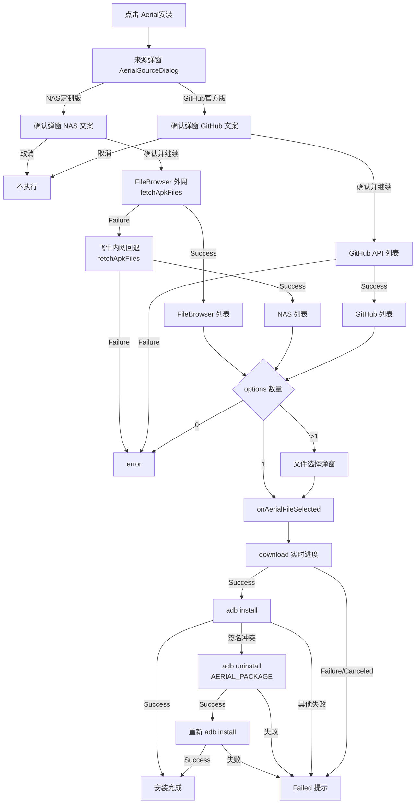

# Aerial 安装功能 · 开发说明文档（可复用）

> 来源项目：skyadb（Compose Multi 移动端 ADB 管理器）
> 功能：从多个远程来源（NAS 定制版 / GitHub 官方版）获取 Aerial APK 列表 → **来源确认** → 用户选择 → 下载 → ADB 推送安装；**签名冲突时自动卸载旧应用重装**
> 复用方式：按第 7 节文件清单拷贝 + 适配来源 URL / 目标设备 ADB 执行器

---

## 1. 功能概述与架构

「Aerial 安装」是设备详情页的一个功能块，整体为 **UI → ViewModel 状态机 → 来源确认 → 来源客户端（远程列表/下载地址）→ 网络下载 → ADB 安装（含签名冲突重装）** 的分层结构：

```
┌─────────────────────────────────────────────────────────────┐
│ UI 层  DeviceScreen.kt                                       │
│   AerialSourceDialog（来源选择）→ AerialSourceConfirmDialog（来源确认）│
│   → AerialFileSelectDialog（文件选择）→ 状态区                  │
└──────────────────────────┬──────────────────────────────────┘
                           │ 回调（onAerial*Click / onAerialSourceConfirm* / onAerialFileSelected）
┌──────────────────────────▼──────────────────────────────────┐
│ 状态层  DeviceViewModel.kt                                    │
│   aerialInstallStatus / aerialSourceDialogVisible /          │
│   aerialSourceLoading / aerialSourceError /                  │
│   aerialSourceConfirm（AerialSourceKind?）                    │
│   aerialFilesDialogVisible / aerialCandidateFiles            │
└──────────────────────────┬──────────────────────────────────┘
                           │ suspend 调用
┌──────────────────────────▼──────────────────────────────────┐
│ 数据层  download 包                                          │
│   FileBrowserShareClient（NAS 定制版·外网优先）                  │
│   FnosShareClient（NAS 定制版·内网回退）                        │
│   NetworkDownloadManager（GitHub 列表 / 通用下载）              │
└──────────────────────────┬──────────────────────────────────┘
                           │
┌──────────────────────────▼──────────────────────────────────┐
│ 设备层  AdbRepository.install / uninstall（ADB push + pm）     │
│   installDownloadedApk：签名冲突 → 自动卸载 AERIAL_PACKAGE → 重装 │
└─────────────────────────────────────────────────────────────┘
```

三种来源统一收敛为 `AerialFileOption`（sealed interface），下载后走**同一套**下载→安装→（签名冲突重装）流水线。

---

## 2. 功能需求（验收标准）

| # | 需求 | 说明 |
|---|------|------|
| R1 | 入口 | 详情页提供「Aerial安装」快捷入口（QuickAction） |
| R2 | 来源选择 | 点击后弹来源框：`NAS定制版Aerial`、`GitHub官方版Aerial` 两个按钮 |
| R3 | **来源确认（必选）** | 点击任一来源按钮后**先弹确认框**（NAS/GitHub 各用锁定文案，说明签名不一致需先卸载旧版）；用户点「确认并继续」才执行后续加载，点「取消」不执行任何操作 |
| R4 | NAS 定制版（双通道） | **优先**走 File Browser 外网公开分享（免认证）获取 APK 列表；外网不可用时**自动回退**飞牛内网分享（share-data 协议） |
| R5 | GitHub 官方版 | 调用 GitHub Releases API（`releases/latest`）列出该仓库最新 Release 的全部 `.apk` 资产 |
| R6 | 文件选择 | 列表 >1 个时弹选择框（等宽文件名）；恰 1 个时直接开始安装；0 个时报"未找到可安装的 APK" |
| R7 | 下载 | 显示实时下载进度（百分比/字节）；支持取消（Canceled 态） |
| R8 | 安装 | 下载完成自动 `adb install`（推送到设备，实时传输进度），安装后删除本地临时文件 |
| R9 | **签名冲突自动卸载重装** | `adb install` 报签名不一致（`INSTALL_FAILED_UPDATE_INCOMPATIBLE` 等）无法覆盖时，**先 `adb uninstall` 电视上的对应应用，再重新安装**同一 APK |
| R10 | 错误呈现 | 获取列表失败、下载失败、安装失败、卸载失败均有 message + suggestion；执行中防重复触发 |

---

## 3. 交互流程（状态机）

```
点击「Aerial安装」
    │ aerialInstallStatus Running 或 aerialSourceLoading → 忽略
    ▼
onAerialInstallClick() → aerialSourceDialogVisible = true
    ▼
AerialSourceDialog（来源选择）
    ├─ 取消 → onAerialSourceDismiss() → 关闭
    ├─ NAS定制版 → onAerialNasSelected()
    │      ├─ 来源弹窗关闭, aerialSourceConfirm = Nas（弹确认框）
    │      └─ （不再直接加载列表！）
    └─ GitHub官方版 → onAerialGithubSelected()
           ├─ 来源弹窗关闭, aerialSourceConfirm = Github（弹确认框）
           └─ （不再直接加载列表！）
    ▼
AerialSourceConfirmDialog（来源确认，文案按 kind 区分）
    ├─ 取消 → onAerialSourceConfirmDismiss() → aerialSourceConfirm = null（不执行）
    └─ 确认并继续 → onAerialSourceConfirmAccept()
           ├─ aerialSourceConfirm = null
           ├─ kind == Nas → loadNasAerialOptions()
           └─ kind == Github → loadGithubAerialOptions()
    ▼
loadNasAerialOptions()：FileBrowser 外网优先 → 失败回退飞牛内网
loadGithubAerialOptions()：GitHub Releases API
    ▼
showOrStartAerialOptions(options)
    ├─ empty → aerialSourceError = "未找到可安装的 APK 文件"
    ├─ size==1 → onAerialFileSelected(唯一项)   ← 直接进入下载安装
    └─ size>1 → AerialFileSelectDialog（aerialFilesDialogVisible=true）
    ▼
onAerialFileSelected(option)   ← 按来源分发
    ├─ FileBrowser → startRemoteDownload(fileName, downloadUrl, cookie=null)
    ├─ Nas → fetchDownloadUrl() 换真实地址 → startRemoteDownload(..., cookie)
    └─ Github → startRemoteDownload(fileName, asset.downloadUrl, cookie=null)
    ▼
startRemoteDownload → NetworkDownloadManager.download（进度回调）
    ├─ Success → installDownloadedApk（adb 传输+安装）
    │       ├─ 安装成功 → 完成
    │       ├─ 安装失败且 isSignatureConflict → 状态「正在卸载旧应用后重新安装…」
    │       │     ├─ adb uninstall AERIAL_PACKAGE 成功 → 重新 adb install（成功→完成；失败→Failed）
    │       │     └─ uninstall 失败 → Failed("卸载旧应用失败", 卸载错误)
    │       └─ 安装失败（其他原因）→ Failed(message, suggestion)
    ├─ Failure → Failed(message, suggestion)
    └─ Canceled → Failed("下载已取消")
```



---

## 4. 数据模型

### 4.1 候选文件（sealed，三来源统一）
```kotlin
sealed interface AerialFileOption {
    val fileName: String

    data class Nas(          // 飞牛内网来源：下载地址需二次换取
        val file: NasShareFile,
        val shareId: String,
        val token: String,
        val cookie: String,
    ) : AerialFileOption { override val fileName: String get() = file.fileName }

    data class FileBrowser(  // File Browser 外网来源：下载地址可直达
        val file: NasShareFile,
    ) : AerialFileOption { override val fileName: String get() = file.fileName }

    data class Github(       // GitHub 来源：下载地址直达
        val asset: ReleaseAsset,
    ) : AerialFileOption { override val fileName: String get() = asset.fileName }
}

/** 来源类型：用于来源确认弹窗与加载分派。 */
enum class AerialSourceKind { Nas, Github }
```

### 4.2 共享文件条目与结果类型（`download` 包）
```kotlin
data class NasShareFile(val fileName: String, val fileId: Long, val path: String, val size: Long)

sealed interface NasFetchResult {
    data class Success(val files: List<NasShareFile>, val shareId: String, val token: String, val cookie: String) : NasFetchResult
    data class Failure(val message: String, val suggestion: String? = null) : NasFetchResult
}
sealed interface NasDownloadResult {
    data class Success(val downloadUrl: String, val cookie: String) : NasDownloadResult
    data class Failure(val message: String, val suggestion: String? = null) : NasDownloadResult
}

data class ReleaseAsset(val fileName: String, val downloadUrl: String)
sealed interface ReleaseFetchResult {
    data class Success(val assets: List<ReleaseAsset>) : ReleaseFetchResult
    data class Failure(val message: String, val suggestion: String? = null) : ReleaseFetchResult
}

sealed interface DownloadResult {
    data class Success(val fileName: String, val localPath: String) : DownloadResult
    data class Failure(val message: String, val suggestion: String?, val cause: Throwable? = null) : DownloadResult
    object Canceled : DownloadResult
}
```

### 4.3 页面状态（`DeviceUiState` Aerial 相关字段）
| 字段 | 类型 | 含义 |
|------|------|------|
| `aerialInstallStatus` | `OperationStatus` | 整体状态（Idle/Running 带进度/Failed） |
| `aerialSourceDialogVisible` | Boolean | 来源弹窗 |
| `aerialSourceLoading` | Boolean | 正在获取列表（防重入） |
| `aerialSourceError` | String? | 列表获取失败文案 |
| `aerialSourceConfirm` | `AerialSourceKind?` | 待确认的来源；非空时显示确认弹窗 |
| `aerialFilesDialogVisible` | Boolean | 文件选择弹窗 |
| `aerialCandidateFiles` | `List<AerialFileOption>` | 候选文件 |

### 4.4 ViewModel 确认相关方法
```kotlin
fun onAerialNasSelected()      // 关来源弹窗，置 aerialSourceConfirm = Nas（不加载）
fun onAerialGithubSelected()   // 关来源弹窗，置 aerialSourceConfirm = Github（不加载）
fun onAerialSourceConfirmAccept()  // 清 confirm，按 kind 分派 loadNasAerialOptions / loadGithubAerialOptions
fun onAerialSourceConfirmDismiss() // 清 confirm，不执行
private fun loadNasAerialOptions()      // 原 NAS 加载逻辑（FileBrowser→飞牛回退）
private fun loadGithubAerialOptions()   // 原 GitHub 加载逻辑
```

---

## 5. 三来源实现详解

### 5.1 NAS 定制版 —— File Browser 外网优先（`FileBrowserShareClient`）

**协议（公开分享，全程免认证，已实测）**：
- 分享链接：`{origin}/share/{hash}`（如 `http://www.890720.xyz:18907/share/XvVjA_os`）
- 列文件：`GET {origin}/api/public/share/{hash}` → 200 JSON：
  ```json
  {"items":[{"path":"/xxx.apk","name":"xxx.apk","size":3057276,"extension":".apk","isDir":false}],
   "numDirs":0,"numFiles":3,"name":"aerial","path":"/","isDir":true}
  ```
- 下载单文件：`GET {origin}/api/public/dl/{hash}/{path}` → 直接返回文件字节流（路径逐段 URL 编码，支持中文文件名）
- 注意：`/api/resources/...` 是私有 API（401，需登录），**勿用**；`/api/public/dl/{hash}/?path=...` 是整目录 zip 打包，**勿用**。

**核心实现**：
```kotlin
class FileBrowserShareClient(shareUrl: String, client: OkHttpClient = ...) {
    private val origin: String   // shareUrl.substringBefore("/share/")
    private val hash: String     // shareUrl.substringAfterLast("/share/")

    suspend fun fetchApkFiles(): NasFetchResult   // GET /api/public/share/{hash}
        // 解析 items → 过滤 isDir=false 且 name 以 .apk 结尾 → NasShareFile 列表
    fun downloadUrl(file: NasShareFile): String   // {origin}/api/public/dl/{hash}/{encodedPath}
}
```
- 成功判定：HTTP 2xx；解析失败 / 无 .apk → `NasFetchResult.Failure`
- 网络异常（IOException）→ Failure，文案提示"将回退到内网 NAS 来源"

### 5.2 NAS 定制版 —— 飞牛内网回退（`FnosShareClient`）

**协议（飞牛 fnOS 分享，需 token+cookie）**：
- 分享链接：`{origin}/s/{shareId}`（如 `http://192.168.5.218:5666/s/41412d18807c4e8499`）
- ① 抓页面 HTML → 正则提取 `<script id="share-data">...</script>` 内嵌 JSON 的 `data.token`
- ② Cookie：`"{shareId}={token}"`
- ③ `POST {origin}/s/{shareId}/api/v1/share/list`（body 含 shareId/path，递归收集，MaxDirectoryDepth=3）→ 文件列表
- ④ `POST {origin}/s/{shareId}/api/v1/share/download`（body 含 files[path,fileId]/shareId/downloadFilename）→ 返回 `data.path` → 下载地址 `origin + path`，下载需带 Cookie
- 签名/鉴权头由 `SignSecret` / `ApiKey` 参与（companion 常量，无需改动）

**核心接口**：
```kotlin
class FnosShareClient(shareUrl: String, client: OkHttpClient = ...) {
    suspend fun fetchApkFiles(): NasFetchResult
    suspend fun fetchDownloadUrl(file: NasShareFile, token: String, cookie: String): NasDownloadResult
}
```

### 5.3 GitHub 官方版（`NetworkDownloadManager.fetchLatestReleaseApks`）

- 输入：Release 网页地址 `https://github.com/{owner}/{repo}/releases/latest`
- 正则转 API：`https://api.github.com/repos/{owner}/{repo}/releases/latest`
- 请求头：`User-Agent: skyadb`、`Accept: application/vnd.github+json`
- 解析 `assets[]`，过滤 `.apk` 后缀 → `ReleaseAsset(fileName, browser_download_url)`

### 5.4 ViewModel 双通道编排（`loadNasAerialOptions`）

```kotlin
viewModelScope.launch {
    when (val fb = fileBrowserShareClient.fetchApkFiles()) {     // ① 外网优先
        is NasFetchResult.Success -> showOrStartAerialOptions(fb.files.map { AerialFileOption.FileBrowser(it) })
        is NasFetchResult.Failure -> {                            // ② 内网回退
            when (val nas = fnosShareClient.fetchApkFiles()) {
                is NasFetchResult.Success -> showOrStartAerialOptions(nas.files.map { AerialFileOption.Nas(...) })
                is NasFetchResult.Failure -> state.aerialSourceError = nas.message
            }
        }
    }
}
```

---

## 6. 下载、安装与签名冲突重装链路

### 6.1 `startRemoteDownload(fileName, url, cookie?)`
- cookie 非空时追加 `Cookie` 请求头（飞牛下载需要），File Browser / GitHub 为 null
- 调 `NetworkDownloadManager.download(url, fileName, headers, onProgress)`，进度回调写入 `aerialInstallStatus`
- 结果分发：`Success → installDownloadedApk`；`Failure → Failed`；`Canceled → Failed("下载已取消")`
- 每次启动新下载前 `downloadJob?.cancel()`；用 `generation` 计数丢弃过期回调（防竞态）

### 6.2 `NetworkDownloadManager.download` 要点
- 校验 URL（`DownloadInputValidator.isHttpUrl`）
- 单实例并发保护：`AtomicReference<Call?>`，同一时刻只允许一个下载；`cancelCurrentDownload()` 可取消
- 文件名优先级：`preferredFileName` → `Content-Disposition` → URL 末段 → 时间戳；再经 `FileNamePolicy.sanitize`
- 落盘：`{cacheDir}/downloads/{uuid}/{fileName}`；保留最近 3 个下载目录（自动清理）
- 进度：150ms 节流回调；未知总长时按字节展示
- 取消：协程取消 → `call.cancel()`，删除半成品文件

### 6.3 `installDownloadedApk`（含签名冲突自动卸载重装）

```kotlin
private suspend fun installDownloadedApk(result: DownloadResult.Success) {
    val file = File(result.localPath)
    val transferCallback: (Long, Long) -> Unit = { transferred, total -> /* adbTransferRunning 进度 */ }
    try {
        state.置 Running("下载完成，正在安装 APK")
        val firstInstall = adbRepository.install(file, transferCallback)
        val installResult =
            if (firstInstall is Failure && isSignatureConflict(firstInstall.message)) {
                // 签名不一致：先卸载电视上的对应应用，再重新安装。
                state.置 Running("签名不一致，正在卸载旧应用后重新安装…")
                when (val uninstall = adbRepository.uninstall(AERIAL_PACKAGE)) {
                    is Success -> adbRepository.install(file, transferCallback)   // 重装
                    is Failure -> Failure("卸载旧应用失败", uninstall.message)
                }
            } else firstInstall
        when (installResult) { Success → 完成; Failure → Failed(message, suggestion) }
    } finally { file.delete() }
}
```

**签名冲突识别**：
```kotlin
private fun isSignatureConflict(message: String?): Boolean {
    val text = message.orEmpty()
    return text.contains("INSTALL_FAILED_UPDATE_INCOMPATIBLE", ignoreCase = true) ||
        text.contains("INCONSISTENT_CERTIFICATES", ignoreCase = true) ||
        text.contains("signatures do not match", ignoreCase = true)
}
```

**目标包名常量**（companion）：
```kotlin
const val AERIAL_PACKAGE = "app.orchard.tv"   // 签名冲突时卸载它再重装
```

---

## 7. 代码结构与复用步骤

### 7.1 需拷贝的文件

| 文件 | 内容 | 是否需要改 |
|------|------|-----------|
| `download/FileBrowserShareClient.kt` | File Browser 公开分享客户端 | 仅改 URL（构造参数） |
| `download/FnosShareClient.kt` | 飞牛分享客户端（含 await 扩展） | **按需**：不需要内网回退可整体去掉 |
| `download/NetworkDownloadManager.kt` | GitHub 列表 + 通用下载 | 否 |
| `download/DownloadResult.kt`（及同包结果类型） | DownloadResult / ReleaseAsset / ReleaseFetchResult / NasShareFile / NasFetchResult / NasDownloadResult | 否 |
| `ui/device/DeviceViewModel.kt` | Aerial 状态字段 + AerialSourceKind + onAerial* 方法 + 确认方法 + startRemoteDownload + installDownloadedApk + isSignatureConflict + showOrStartAerialOptions | 并入自身 ViewModel |
| `ui/device/DeviceScreen.kt` | AerialSourceDialog / AerialSourceConfirmDialog / AerialFileSelectDialog / 状态区 UI | 并入自身 UI |
| `repository/AdbRepository.kt` | `install()` / `uninstall()` 接口 | 适配自身 ADB 执行器 |
| `res/values*/strings.xml` | `aerial_*` / `common_transferring_arg` / `common_installing_arg` / `common_apk_install_success` / `download_complete_installing_apk` / `download_canceled*` 等 | 复制 |

### 7.2 最小适配点

| 适配项 | 位置 | 说明 |
|--------|------|------|
| File Browser 外网分享 URL | `DeviceViewModel` companion `FileBrowserShareUrl` | **必改**：换成自己的分享链接 `{origin}/share/{hash}` |
| 飞牛内网分享 URL（回退） | companion `NasShareUrl` | 不需要内网回退则删掉对应分支 |
| GitHub Release 地址 | companion `GithubReleaseUrl` | **必改**：目标仓库 `releases/latest` |
| 签名冲突卸载包名 | companion `AERIAL_PACKAGE` | **必改**：目标应用包名 |
| ADB 安装/卸载执行器 | `AdbRepository.install` / `uninstall` | 替换为自身 ADB 能力（push + pm install / pm uninstall） |
| 来源确认文案 | strings.xml `aerial_source_confirm_nas` / `_github` | 按需替换为自身口径 |
| 下载缓存目录 | `NetworkDownloadManager.downloadDir` | 默认 `cacheDir/downloads`，一般无需改 |
| 字符串资源 | strings.xml | 复制 `aerial_*` 与相关 `download_*`/`common_*` |

### 7.3 依赖清单
- OkHttp（OkHttpClient / Call / Response）与 Okio
- kotlinx-coroutines（`viewModelScope.launch`、`suspendCancellableCoroutine`、`Dispatchers.IO`、`delay`）
- Compose Material3（AlertDialog / OutlinedButton / Text / LinearProgressIndicator）
- 设备侧：kadb（或等价 ADB 库）提供 `install(File, onProgress)`、`uninstall(packageName)` 与 `shell`
- JSON：`org.json`（Android 内置）

### 7.4 接入步骤
1. 拷贝 7.1 文件到对应包；
2. 改 companion 三个 URL 常量 + `AERIAL_PACKAGE`（或删除不需要的来源分支）；
3. 将 `AdbRepository.install` / `uninstall` 接到自身 ADB 实现；
4. 在页面添加入口按钮，挂 `onAerialInstallClick`；
5. 复制相关字符串资源（含 6 条确认/签名冲突新 key）；
6. 编译验证；连接电视实测 来源选择 → 确认 → 列表 → 下载 → 安装 → （签名冲突自动卸载重装） 全链路。

---

## 8. 错误处理与边界

| 场景 | 行为 |
|------|------|
| 执行中重复点击入口/来源/文件 | `aerialInstallStatus Running` 或 `aerialSourceLoading` 时全部忽略 |
| 未确认来源 | 点击来源按钮只弹确认框，不加载、不下载、不安装 |
| 确认框取消 | `aerialSourceConfirm = null`，无任何副作用 |
| 外网 File Browser 不可达 / 解析失败 / 无 APK | 自动回退飞牛；回退也失败才显示错误 |
| GitHub API 非 2xx | Failure + 服务端 code 建议 |
| 无 .apk 资产 | "未找到可安装的 APK 文件" |
| 下载取消（协程取消/主动 cancel） | 清理半成品，显示"下载已取消" |
| 下载目标文件已存在/命名非法 | `FileNamePolicy.sanitize` 处理 |
| **安装签名冲突（INSTALL_FAILED_UPDATE_INCOMPATIBLE 等）** | 自动卸载 `AERIAL_PACKAGE` → 重装；卸载失败报「卸载旧应用失败」并附原因 |
| 下载或安装失败 | Failed(message, suggestion)，可重试 |
| 竞态 | `generation` 计数丢弃过期回调；下载管理器单实例保护 |

---

## 9. 字符串资源清单（`aerial_*` 及安装链路用到的公共串）

| key | 用途 |
|-----|------|
| `action_aerial_install` | 入口按钮" Aerial安装" |
| `aerial_source_title` / `aerial_source_nas` / `aerial_source_github` | 来源弹窗标题 / NAS定制版 / GitHub官方版 |
| `aerial_source_confirm_title` | 来源确认弹窗标题 |
| `aerial_source_confirm_nas` | NAS 定制版确认文案（官方版→定制版签名不一致，需先卸载官方版…） |
| `aerial_source_confirm_github` | GitHub 官方版确认文案（定制版→官方版签名不一致，需先卸载定制版…） |
| `aerial_source_confirm_accept` | 确认按钮"确认并继续"（取消复用 `action_cancel`） |
| `aerial_fetching_files` | 获取列表 loading |
| `aerial_select_file_title` | 文件选择弹窗标题 |
| `aerial_no_apk_found` | 无 APK 提示 |
| `aerial_preparing_download` / `aerial_download_starting` | 准备下载 / 开始下载 |
| `aerial_signature_conflict_uninstalling` | 签名不一致，正在卸载旧应用后重新安装… |
| `aerial_signature_conflict_uninstall_failed` | 卸载旧应用失败 |
| `common_transferring_arg` / `common_installing_arg` / `common_apk_install_success` | ADB 传输中 / 安装中 / 安装完成 |
| `download_complete_installing_apk` | 下载完成进入安装 |
| `download_canceled` / `download_canceled_hint` | 取消提示 |
| `download_invalid_url*` / `download_failed*` | 下载通用错误（含服务器 code 建议） |

---

*文档基于 skyadb 实际源码整理；适配参数集中见 §7.2，来源确认流程见 §3/§4.4，签名冲突重装链路见 §6.3，NAS 双通道协议细节见 §5.1–5.2。*
