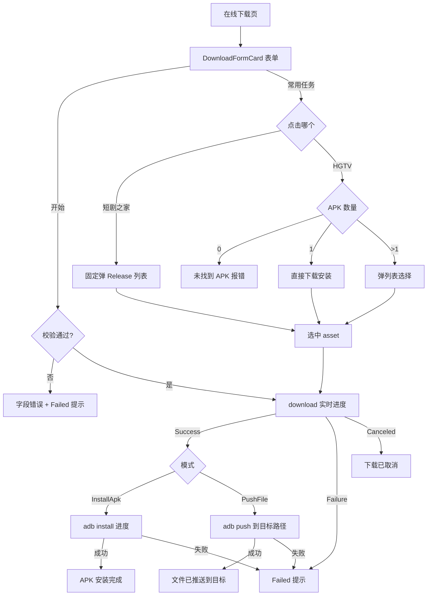

# 在线下载功能 · 开发说明文档（可复用）

> 来源项目：skyadb（Compose Multi 移动端 ADB 管理器）
> 功能：输入远程文件链接 → 下载到本地 → 按模式「安装 APK」adb 安装 / 「推送文件」adb push 到设备目录；并提供**常用任务**（短剧之家 / HGTV）一键拉取 GitHub Release 最新 APK（单文件直装 / 多文件列表选择）
> 复用方式：按第 7 节文件清单拷贝 + 适配常用任务 URL / 目标设备 ADB 执行器

---

## 1. 功能概述与架构

「在线下载」是独立的一页（`ui/download` 包），整体为 **UI 表单 → ViewModel 校验与状态机 → 下载管理器 → ADB 安装/推送** 的分层结构：

```
┌─────────────────────────────────────────────────────────────┐
│ UI 层  OnlineDownloadScreen.kt                               │
│   DownloadFormCard（模式/URL/目标路径/开始/取消）               │
│   FavoriteTaskCard（常用任务：短剧之家 / HGTV）                 │
│   DownloadTaskCard（任务状态卡片）→ DownloadStatusMessage       │
│   ReleaseAssetsDialog（Release APK 列表选择）                   │
└──────────────────────────┬──────────────────────────────────┘
                           │ 回调（onModeChanged / onUrlChanged / onStartClick /
                           │  onFavoriteTaskClick / onHgvClick / onReleaseAssetSelected …）
┌──────────────────────────▼──────────────────────────────────┐
│ 状态层  OnlineDownloadViewModel.kt                           │
│   mode / url / targetPath / 校验错误                          │
│   actionEnabled / task(DownloadTask) / operationStatus       │
│   releaseDialogVisible / releaseLoading / releaseAssets / releaseError │
└──────────────────────────┬──────────────────────────────────┘
                           │ suspend 调用
┌──────────────────────────▼──────────────────────────────────┐
│ 数据层  download 包                                          │
│   NetworkDownloadManager（download 通用下载 / fetchLatestReleaseApks）│
│   DownloadTask / DownloadState / DownloadResult               │
└──────────────────────────┬──────────────────────────────────┘
                           │
┌──────────────────────────▼──────────────────────────────────┐
│ 设备层  AdbRepository.install / push（ADB 实时进度）            │
└─────────────────────────────────────────────────────────────┘
```

---

## 2. 功能需求（验收标准）

| # | 需求 | 说明 |
|---|------|------|
| R1 | 入口 | 设备详情页「快捷操作」区提供「在线下载」入口，独立页面带返回 |
| R2 | 双模式 | 分段按钮切换：`下载 APK 并安装` / `下载文件并推送`；PushFile 模式额外显示「设备目标目录」输入框 |
| R3 | 输入校验 | URL 必须为 `http(s)://`；InstallApk 模式要求以 `.apk` 结尾；PushFile 模式校验目标路径合法性；校验失败给出逐字段错误 + 禁止开始 |
| R4 | 下载 | 点击「开始」下载：显示实时进度（百分比/字节），文件名自动获取（优先用户输入 → Content-Disposition → URL 末段） |
| R5 | 安装/推送 | 下载完成后自动衔接：InstallApk → `adb install`（实时传输进度）；PushFile → `adb push` 到 `目标路径/文件名` |
| R6 | 取消 | 可随时取消当前下载：清理半成品文件，状态置「下载已取消」 |
| R7 | 常用任务 | 「常用任务」卡片内嵌两个任务：**短剧之家**（弹列表选择）、**HGTV**（单 APK 直接下载安装，多 APK 弹列表选择，无 APK 报错） |
| R8 | Release 列表 | 弹窗展示获取中/错误/空/列表四态；列表项为等宽按钮，带架构友好标签（arm64-v8a→64位/armeabi-v7a→32位） |
| R9 | 防重入 | 下载执行中忽略重复开始与模式/URL/路径修改；常用任务获取中防重复点击 |
| R10 | 状态呈现 | 任务卡片展示 文件名/消息/进度条/状态/目标；整体状态区展示 运行/成功/失败(含建议) |

---

## 3. 交互流程（状态机）

```
进入「在线下载」页
    ▼
DownloadFormCard（默认 InstallApk 模式）
    ├─ 切换模式 → onModeChanged → updateForm（PushFile 时显示目标路径输入框）
    ├─ 输入 URL → onUrlChanged → 实时校验 → actionEnabled
    └─ 输入目标路径（PushFile）→ onTargetPathChanged → 实时校验
    ▼
点击「开始」→ onStartClick
    ├─ downloadJob 活跃 → 忽略（防重入）
    ├─ 校验失败 → 置字段错误 + Failed("无法开始下载", "请先检查下载链接和目标路径。")
    └─ 校验通过 →
          actionEnabled=false, task=Waiting("等待获取文件名…")
          downloadManager.download(url) { task → 实时进度 }
          ├─ Success → handleDownloadedFile(form, result)
          │     ├─ InstallApk → adbRepository.install（进度）→ Success("APK 安装完成") / Failed
          │     └─ PushFile → adb push 到 目标路径/文件名 → Success("文件已推送到 X") / Failed
          ├─ Failure → Failed(message, suggestion) + task=Failed
          └─ Canceled → Failed("下载已取消", hint) + task=Canceled
点击「取消」→ onCancelClick
    └─ generation++ / cancelCurrentDownload() / downloadJob.cancel() → 状态置已取消

常用任务：
    ├─ 点击「短剧之家」→ onFavoriteTaskClick → 弹 ReleaseAssetsDialog（固定列表，多 APK 才可选）
    └─ 点击「HGTV」→ onHgvClick →
          ├─ 0 个 APK → releaseError = "该 Release 未找到可安装的 APK 文件"
          ├─ 1 个 APK → onReleaseAssetSelected(asset)（直接下载安装）
          └─ 多个 APK → ReleaseAssetsDialog（选择哪个下载安装哪个）
    ▼
选中 asset → onReleaseAssetSelected(asset)
    └─ 关弹窗 → mode=InstallApk, url=asset.downloadUrl, actionEnabled=true
       → 自动调用 onStartClick() 开始下载安装
```



---

## 4. 数据模型

### 4.1 模式枚举
```kotlin
enum class OnlineDownloadMode(@param:StringRes val labelRes: Int) {
    InstallApk(R.string.download_mode_install_apk),   // 下载 APK 并安装
    PushFile(R.string.download_mode_push_file),        // 下载文件并推送
}
```

### 4.2 页面状态（`OnlineDownloadUiState`）
| 字段 | 类型 | 含义 |
|------|------|------|
| `mode` | `OnlineDownloadMode` | 当前模式 |
| `url` / `targetPath` | String | 下载链接 / 设备目标目录（默认 `/sdcard/Download/`） |
| `urlError` / `targetPathError` | String? | 逐字段校验错误 |
| `actionEnabled` | Boolean | 「开始」可用性（校验通过才为 true） |
| `task` | `DownloadTask?` | 当前任务（进度/状态/目标） |
| `operationStatus` | `OperationStatus` | 整体状态（Idle/Running/Success/Failed） |
| `releaseDialogVisible` | Boolean | Release 列表弹窗 |
| `releaseLoading` | Boolean | 正在获取 Release |
| `releaseAssets` | `List<ReleaseAsset>` | Release APK 资产 |
| `releaseError` | String? | 获取失败文案 |

### 4.3 任务与状态（`download` 包）
```kotlin
data class DownloadTask(
    val url: String, val fileName: String, val targetPath: String,
    val localPath: String? = null, val progress: Float, val state: DownloadState,
    val message: String = appString(state.labelRes),
)

enum class DownloadState(@param:StringRes val labelRes: Int) {
    Waiting, Downloading, Pushing, Installing, Success, Failed, Canceled
}

sealed interface DownloadResult {
    data class Success(val fileName: String, val localPath: String) : DownloadResult
    data class Failure(val message: String, val suggestion: String, val cause: Throwable? = null) : DownloadResult
    data object Canceled : DownloadResult
}
```

### 4.4 Release 资产与获取结果
```kotlin
data class ReleaseAsset(val fileName: String, val downloadUrl: String)

sealed interface ReleaseFetchResult {
    data class Success(val assets: List<ReleaseAsset>) : ReleaseFetchResult
    data class Failure(val message: String, val suggestion: String? = null) : ReleaseFetchResult
}
```

---

## 5. 核心逻辑详解

### 5.1 表单校验（`validate`）
- `DownloadInputValidator.urlError(value, requireApk = mode == InstallApk)`：非空、`http(s)://` 前缀；InstallApk 模式额外要求 `.apk` 结尾（大小写不敏感）
- `DevicePathValidator.pathError(targetPath, labelRes)`：PushFile 模式校验设备路径
- `valid = url.isNotBlank() && urlError == null && (InstallApk || 路径非空且合法)`
- 输入变化即重算校验（`updateForm`），执行中（`downloadJob?.isActive`）忽略表单修改

### 5.2 开始下载（`onStartClick`）
1. 防重入：`downloadJob?.isActive == true` 直接返回
2. `generation++` 建立任务代次（用于丢弃过期回调）
3. 校验失败 → 字段错误 + `Failed("无法开始下载", "请先检查下载链接和目标路径。")`
4. 通过 → 置 Waiting 任务 → `downloadManager.download(current.url) { task -> 实时更新 }`

### 5.3 下载完成处理（`handleDownloadedFile`，双模式）
- **InstallApk**：`task=Installing("下载完成，正在安装 APK")` → `adbRepository.install(file, onProgress)`（`adbTransferRunning` 渲染"正在传输/正在安装"）→ 成功 `Success("APK 安装完成")` / 失败 `Failed(message, suggestion)`
- **PushFile**：`remotePath = targetPath.trimEnd('/') + "/" + fileName` → `task=Pushing("下载完成，正在推送文件")` → `adbRepository.push(file, remotePath, onProgress)`（"正在推送文件/正在完成推送"）→ 成功 `Success("文件已推送到 {remotePath}")` / 失败 `Failed`
- `finally { file.delete() }`：无论成败删除本地临时文件

### 5.4 常用任务（短剧之家 / HGTV）
ViewModel 内两个常量：
```kotlin
const val FAVORITE_TASK_URL = "https://github.com/jackherex/duanjuzhijia-down-tv/releases/latest"   // 短剧之家
const val HGV_TASK_URL = "https://github.com/pan8664716/HGTV/releases/latest"                       // HGTV
```

两个任务共用 Release 获取逻辑（`fetchLatestReleaseApks` → 过滤 `.apk` 资产），分发差异：

| 任务 | 点击行为 |
|------|----------|
| 短剧之家 `onFavoriteTaskClick` | **始终弹 ReleaseAssetsDialog**（loading → 列表/错误） |
| HGTV `onHgvClick` | **单文件直装**：`assets.size == 1` → 直接 `onReleaseAssetSelected(first)`（不弹列表）；多文件 → 弹列表；0 个 → `releaseError = "该 Release 未找到可安装的 APK 文件"` |

选中资产 `onReleaseAssetSelected(asset)`：关弹窗 → `mode=InstallApk, url=asset.downloadUrl, actionEnabled=true` → 自动 `onStartClick()` 走标准下载安装链路。

### 5.5 Release 弹窗（`ReleaseAssetsDialog`）
四态渲染：`loading` 转圈（"正在获取最新版本…"）→ `error` 红字 → `assets 为空`（"未找到 APK 文件"）→ 列表逐项 `OutlinedButton`（等宽，标签映射）：
```kotlin
fun releaseAssetLabel(fileName: String): String = when {
    fileName.contains("arm64-v8a", ignoreCase = true) -> "64位，客厅电视安装"
    fileName.contains("armeabi-v7a", ignoreCase = true) -> "32位，主卧电视安装"
    else -> fileName
}
```

---

## 6. 下载管理器实现要点（`NetworkDownloadManager`）

```kotlin
suspend fun download(
    url: String,
    preferredFileName: String? = null,
    headers: Map<String, String> = emptyMap(),
    onProgress: (DownloadTask) -> Unit,
): DownloadResult
```
- **校验**：`DownloadInputValidator.isHttpUrl(url)`，非法 → `Failure("下载链接无效", "请输入以 http:// 或 https:// 开头的下载链接。")`
- **单实例并发保护**：`AtomicReference<Call?>` + `check(activeCall.compareAndSet(null, call))`；协程取消自动 `call.cancel()`（cancellationWatcher）
- **文件名优先级**：`preferredFileName` → `Content-Disposition filename=` → URL 末段（URL 解码）→ `download-{时间戳}`；再经 `FileNamePolicy.sanitize`
- **落盘**：`{cacheDir}/downloads/{uuid}/{fileName}`；每次下载前 `cleanupDownloadDir` 仅保留最近 **3** 个缓存目录
- **进度**：150ms 节流回调 `DownloadTask(state=Downloading, progress, message)`；总长未知时按字节展示（`formatBytes`）
- **取消**：读取中 `call.isCanceled()` → 删除半成品 → `Canceled`
- **非 2xx**：`Failure("下载失败", "服务器返回 {code}，请检查链接是否可访问。")`
- **异常**：`operationCatching` 捕获（`CancellationException` 原样抛出）→ `Failure("下载失败", 通用建议)`

```kotlin
suspend fun fetchLatestReleaseApks(releaseWebUrl: String): ReleaseFetchResult
```
- URL 转换：`Regex("^https?://github\\.com/([^/]+)/([^/]+)/releases(?:/.*)?$")` → `https://api.github.com/repos/{owner}/{repo}/releases/latest`
- 请求头：`User-Agent: skyadb`、`Accept: application/vnd.github+json`
- 解析 `assets[]`，仅收集 `name.endsWith(".apk")` 的资产

---

## 7. 代码结构与复用步骤

### 7.1 需拷贝的文件

| 文件 | 内容 | 是否需要改 |
|------|------|-----------|
| `download/NetworkDownloadManager.kt` | 通用下载 + GitHub Release 列表 | 否（可原样拷贝） |
| `download/DownloadTask.kt` | DownloadTask / DownloadState / DownloadResult | 否 |
| `download/DownloadResult.kt`（及同包结果类型） | ReleaseAsset / ReleaseFetchResult | 否 |
| `validation/DownloadInputValidator.kt` | URL / APK 后缀校验 | 否 |
| `validation/DevicePathValidator.kt` | 设备路径校验 | 按需 |
| `ui/download/OnlineDownloadViewModel.kt` | 状态字段 + onStartClick / handleDownloadedFile / 常用任务方法 | **改 URL 常量**（companion） |
| `ui/download/OnlineDownloadScreen.kt` | 表单卡片 / 常用任务卡片 / 任务状态 / Release 弹窗 | 并入自身 UI |
| `repository/AdbRepository.kt` | `install()` / `push()` 接口 | 适配自身 ADB 执行器 |
| `res/values*/strings.xml` | `online_download_*` / `download_*` / `download_state_*` 等 | 复制 |

### 7.2 最小适配点

| 适配项 | 位置 | 说明 |
|--------|------|------|
| 短剧之家 Release URL | `OnlineDownloadViewModel` companion `FAVORITE_TASK_URL` | **必改**：换成自己的 Release 地址 |
| HGTV Release URL | companion `HGV_TASK_URL` | **必改**：换成自己的 Release 地址 |
| 常用任务按钮与行为 | `FavoriteTaskCard` + `onFavoriteTaskClick` / `onHgvClick` | 可增删任务项；单文件直装 / 多文件列表策略按需求调整 |
| ADB 安装/推送执行器 | `AdbRepository.install` / `push` | 替换为自身 ADB 能力 |
| 下载缓存目录 | `NetworkDownloadManager.downloadDir` | 默认 `cacheDir/downloads`，一般无需改 |
| 设备目标目录默认值 | `OnlineDownloadUiState.targetPath` | 默认 `/sdcard/Download/` |
| 架构标签文案 | `releaseAssetLabel` | 按自身设备布局调整 |
| 字符串资源 | strings.xml | 复制 `online_download_*` / `download_*` |

### 7.3 依赖清单
- OkHttp（OkHttpClient / Call / Response / enqueue）与 Okio
- kotlinx-coroutines（`viewModelScope.launch`、`withContext(Dispatchers.IO)`、`suspendCancellableCoroutine`、`CoroutineStart.UNDISPATCHED`、`ensureActive`）
- Compose Material3（SegmentedButton / OutlinedTextField / Card / AlertDialog / LinearProgressIndicator）
- 设备侧：kadb（或等价 ADB 库）提供 `install(File, onProgress)`、`push(File, remotePath, onProgress)`
- JSON：`org.json`（Android 内置）

### 7.4 接入步骤
1. 拷贝 7.1 文件到对应包；
2. 改 companion 两个常用任务 URL；
3. 将 `AdbRepository.install` / `push` 接到自身 ADB 实现；
4. 在导航中添加「在线下载」页面与入口；
5. 复制相关字符串资源；
6. 编译验证；连接设备实测 表单下载安装 / 推送 / 短剧之家列表 / HGTV 单文件直装 全链路。

---

## 8. 错误处理与边界

| 场景 | 行为 |
|------|------|
| 下载执行中重复开始 / 改表单 | `downloadJob?.isActive` 为 true 时忽略（防重入） |
| URL 非法 / InstallApk 非 .apk | 字段错误实时提示 + `actionEnabled=false`；开始时报「无法开始下载」 |
| 常用任务获取中重复点击 | `releaseLoading` 时忽略 |
| HGTV 无 APK 资产 | `releaseError = "该 Release 未找到可安装的 APK 文件"`（弹窗内红字） |
| 下载服务器非 2xx | `Failed("下载失败", "服务器返回 {code}…")` |
| 下载中途取消 | 删除半成品文件，状态 `Canceled` + 「下载已取消」提示 |
| 安装/推送失败 | `Failed(message, suggestion)`，任务置 Failed |
| 本地文件清理 | 下载后无论成败 `finally { file.delete() }` |
| 并发下载 | 下载管理器单实例保护，重复下载抛 `IllegalStateException` 由 operationCatching 归一 |
| 竞态 | `generation` 代次计数丢弃过期进度回调 |

---

## 9. 字符串资源清单（`online_download_*` / `download_*`）

| key | 用途 |
|-----|------|
| `online_download_title` | 页面标题「在线下载」 |
| `online_download_task_title` / `_task_status_title` | 表单卡片 / 任务状态卡片标题 |
| `online_download_url_label` / `_target_path_label` | URL / 设备目标目录输入框标签 |
| `online_download_no_task` / `_status_format` / `_target_format` | 暂无任务 / 状态 / 目标格式 |
| `action_start` / `action_cancel` | 开始 / 取消按钮 |
| `download_mode_install_apk` / `download_mode_push_file` | 分段按钮文案 |
| `download_invalid_url` / `_suggestion` | URL 无效提示 |
| `download_failed` / `_server_code_suggestion` / `_generic_suggestion` | 下载失败与建议 |
| `download_progress_percent` / `download_progress_bytes` | 进度文案 |
| `download_complete` / `download_complete_installing_apk` / `download_complete_pushing` | 完成态 |
| `download_pushing_file` / `download_finishing_push` / `download_push_complete` / `download_pushed_to` | 推送过程文案 |
| `download_state_waiting` / `_downloading` / `_pushing` / `_installing` / `_success` / `_failed` / `_canceled` | DownloadState 标签 |
| `download_cannot_start` / `download_check_url_path` | 开始前校验失败 |
| `download_preparing` / `download_waiting_filename` | 准备下载 / 等待文件名 |
| `download_canceled` / `download_canceled_hint` | 取消提示 |
| `download_release_no_apk` | Release 无 APK 提示 |
| `common_transferring_arg` / `common_installing_arg` / `common_apk_install_success` | ADB 传输 / 安装 / 完成 |

---

*文档基于 skyadb 实际源码整理；适配参数集中见 §7.2，常用任务行为差异见 §5.4，下载链路见 §5.2–5.3 与 §6。*
